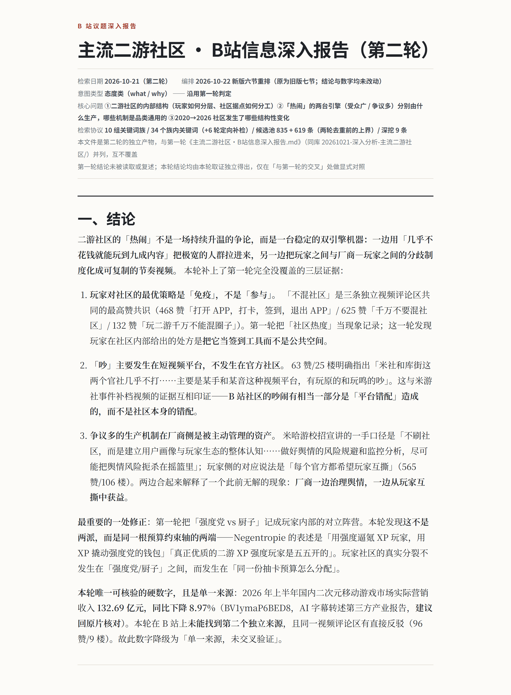
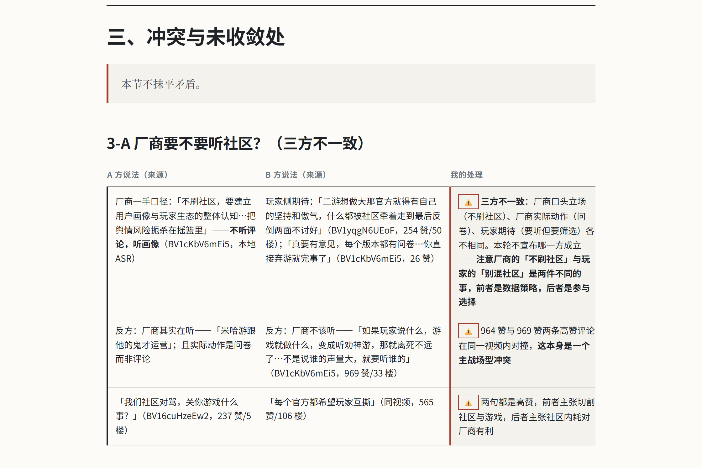

<h1 align="center">bilibili-info-gathering</h1>

<p align="center">
  <a href="README.md">简体中文</a> · <a href="README.en.md"><b>English</b></a>
</p>

<p align="center">
  <b>Start from one topic, and turn scattered Bilibili evidence into a map you can audit.</b><br>
  <sub>It never answers "what did this video say" — it answers "how should this be read, and on what grounds".</sub>
</p>

<p align="center">
  <a href="https://github.com/DavidLearning1023/bilibili-info-gathering/actions/workflows/tests.yml"></a>
  
  <a href="LICENSE"></a>
  
  
</p>

<p align="center">
  <a href="#try-it">Try it</a> ·
  <a href="#30-second-fit-check">Who it's for</a> ·
  <a href="#why-it-exists">Why it exists</a> ·
  <a href="#how-this-differs-from-other-bilibili-mcps">How it differs</a> ·
  <a href="#quick-start">Quick start</a> ·
  <a href="#known-limitations">Known limitations</a> ·
  <a href="#contributing">Contributing</a>
</p>

<p align="center">
  
</p>

<p align="center">
  👀 The image above is the <b>opening of a real report</b>, not a mockup.<br>
  <a href="examples/20261021-主流二游社区·B站信息深入报告（第二轮）.html">Read a complete deep report (92 KB, single-file HTML — just open it)</a>
</p>

<p align="center">
  <sub>Topic-level evidence gathering from Bilibili: dual-axis source grading, conflicts listed side by side, gaps declared, retrieval protocol replayable. An MCP server plus a methodology skill for agents.</sub>
</p>

---

## Try it

Once installed (see [Quick start](#quick-start)), the **first thing you say** to your agent looks like this — just swap the quoted topic for your own:

```
Tell me what Bilibili people say about ‘whether ordinary people's investment advice actually holds up’.
```

**You never specify "deep" or "brief"** — **your wording decides the mode**:

| What you say | What it does |
|---|---|
| "Tell me about X on Bilibili" | **Deep**: 10–20 minutes, produces md + HTML + PDF |
| "Give me a **brief** read on Bilibili's take on X" | **Brief**: 3–5 minutes, markdown only |

> You may paste BV ids in the background as leads
> (`Tell me about X on Bilibili. Background: BV1fxni6XEwD`), but that is **not** an analysis
> request — those are leads for the topic, not "summarize this video for me".

A deep-mode report opens like this (the image above): **3–5 sentences of judgement, each carrying
concrete evidence** (upvote counts, reply counts, and a BV id where it matters). And the closing
line — "the only hard number in this run… **single source, not cross-verified**" — **downgrades
its own conclusion on purpose**. That discipline is the core of the pipeline.

---

## 30-second fit check

| What you want to do | Does it do that? | Use instead |
|---|:---:|---|
| "What do people on Bilibili think about **X**?" / "Has anyone on Bilibili done **X**?" | ✅ **This is exactly it** | This project, deep or brief |
| "What does this video say? Summarize it." | ❌ Out of scope | [bilibili-video-analysis-summary](https://github.com/DavidLearning1023/bilibili-video-analysis-summary) |
| "Just pull the comments off a few Bilibili videos." | ⚠️ It can, but you don't need the methodology | Any lightweight fetch-only MCP |
| "Track an UP主 (uploader) / keyword's popularity daily." | ❌ Out of scope | A scheduled daily-digest tool |

**The boundary in one line**: it serves people who need a conclusion **to argue with, or to put
in front of a third party**. It does not serve people who want an answer in three minutes —
they will only find it slow.

---

## Why it exists

Doing research on Bilibili the obvious way — "search it, read a few" — fails in five
very concrete ways:

| The trap you hit | What this project does about it |
|---|---|
| **Biased sample** — search 10 videos, assume you've seen it all | Multi-word-family sweeping + an explicit retrieval-scope and bias statement (the tool returns `bias_note`) |
| **Blurred scoring** — a big UP主 speaking outside their field vs. an anonymous user pasting the raw government statistics both come out "medium" | **Dual-axis grading**: source A–F × topic usability 1–4 |
| **False consensus** — 10 reuploads echoing each other look like "everyone agrees" | **Redundancy tags**: original / redundant / conflicting |
| **Never stopping** — "breadth first" degrades into "keep searching" | **Three-tier exit rules** (list-level / content-level / topic-level) |
| **Repeated work** — the same video gets analysed three times | Video index + source library, reused across topics |

The methodology isn't invented here. It's assembled from four mature frameworks: REA rapid
evidence assessment (UK GSR / Cochrane), Admiralty / NATO intelligence grading,
information foraging theory (Pirolli & Card, 1999), and SIFT / lateral reading (Caulfield).
The derivation lives in `references/` — it isn't a one-line "inspired by industry best practice".

---

## How this differs from other Bilibili MCPs

Other Bilibili MCPs do good work — [`@xzxzzx/bilibili-mcp`](https://github.com/xzxzzx/bilibili-mcp)
is the representative example — but they all sit at the **data-fetching layer**: turning search,
comments and subtitles into structured JSON. This project does that too (14 tools), but the real
difference is one layer up —

| Dimension | Fetch-only MCP (e.g. `@xzxzzx/bilibili-mcp`) | This project |
|---|---|---|
| Question it answers | "Give me the data" | "**Who should I trust here, and what's still missing?**" |
| Output | Raw JSON | Conclusion + source map + conflicts + gap statement |
| Grading | None, or a single score | **Dual axis**: source credibility × topic usability |
| Conflicts | Buried in prose; the reader has to spot them | **Its own section**, both sides shown, no verdict forced |
| What it doesn't know | Usually not stated | **Three kinds of gaps**, each one actionable |
| Reproducibility | Hard | Retrieval protocol + a call ledger on disk, so the numbers can be recomputed |

**What "conflicts get their own section" looks like** — the one thing a fetch-only MCP will never
give you. From the same real report, section 3-A:



The two can be **installed side by side**: none of the 14 tool names collide with the upstream ones.
MCP is responsible only for "get clean data"; all judgement lives in the methodology skill —
because the grading standard depends on the topic and the purpose, and hardcoding it would
calcify.

> For single-video deep reading, keep using the upstream MCP; inside this project, always use this
> project's own MCP. See
> [INSTALL.md §6](INSTALL.md#六与上游-xzxzzxbilibili-mcp-的关系).

---

## Architecture: MCP does the hands, the skill does the brain

```
        ┌──────────────────────────────┐
        │  SKILL.md  judgement layer   │  dual-axis grading / exit rules / redundancy / synthesis
        └──────────────┬───────────────┘
                       │ calls
        ┌──────────────▼───────────────┐
        │  MCP server  data layer      │  search / comments / subtitles / danmaku / images / registry
        │                (deterministic)│
        └──────────────────────────────┘
```

This split has one verifiable benefit: **the evidence bar doesn't drop when you switch models**.
Judgement is made by a strong model, but every layer's inputs and outputs are structured fields,
so someone else can audit your conclusion against the ledger.

---

## Deep vs. brief mode

**Your wording decides — you never get a questionnaire.** The system switches by itself.

| | **Deep** (default) | **Brief** |
|---|---|---|
| **What you say** | "Tell me about **X** on Bilibili"<br>"What's the state of **X** on Bilibili" | "Give me a **brief** read on Bilibili's take on X"<br>"**Quickly** summarize what Bilibili thinks about X" |
| **What you get** | Decision-level conclusion + full evidence chain<br>(source map / findings / conflicts / gaps / bias statement)<br>**md + HTML + PDF** | Conclusion + key findings + main conflict + biggest gap<br>**markdown only by default** (ask for HTML/PDF and you'll get it) |
| **Roughly** | 10–20 minutes / ~40 tool calls | 3–5 minutes / ~10 tool calls |

> **"Tool calls" ≠ "upstream requests"**: one `scan_topic` call fans out to one upstream request
> per keyword, so 40 tool calls correspond to roughly 300 upstream requests. Both numbers are
> listed separately in report §5 and in the ledger; they are never converted into each other
> and never mixed.

The two modes are **not "high quality vs. low quality" — they're "how much sample you took"**:

- Brief mode cuts **channels** (no subtitles, no frame grabs, no ASR) and **process**
  (no counter-evidence pass, no opinion clustering, no retrieval protocol on disk)
- It does **not** cut the evidence bar — grading, cross-verification tags and the bias statement
  are all still there

**Smaller sample, but the words still have to count.**

> **Use brief** when you just need a trustworthy read on the direction, to decide whether it's worth
> spending another ten minutes on a deep run.
> **Use deep** when the artifact has to survive an argument, or go into material a third party reads.

---

## What comes out, and where it lands

**Reports don't live in `.registry/`** (that's machine state — dot-prefixed and hidden by default).
Everything a human reads lands in **`分析报告库/`** at the project root — a Chinese directory
name, because its reader is **you**, not the code.

```
分析报告库/
└── 20261022-深入分析-主流二游社区/
    ├── 主流二游社区·B站信息深入报告.md      ← the single source of truth (hand-written by the agent)
    ├── 主流二游社区·B站信息深入报告.html    ← script-generated, single file, no external assets
    └── 主流二游社区·B站信息深入报告.pdf     ← A4 print
```

| Slot | Rule | Example |
|---|---|---|
| Date | `YYYYMMDD`; multiple runs on the same topic each get their own directory, **never overwritten** | `20261022` |
| Mode | `深入分析` / `简要分析` | `深入分析` |
| Topic | Copied from your wording (Windows-illegal characters replaced with `-`) | `主流二游社区` |
| Document title | Deep → `·B站信息深入报告`; brief → `·B站信息简报` | `主流二游社区 ·B站信息深入报告` |

> The path is **computed by code**: `python -m big.cli report-path --topic "…" --mode deep --mkdir`.
> The three classic hand-typed mistakes (`2026-10-22` instead of `20261022`, `深入` instead of
> `深入分析`, a `/` inside the topic) don't raise an error — they just scatter your reports across
> two or three directories. See [Quick start](#quick-start) for installation.

### The report structure (the order is not negotiable)

| Section | What goes in | Why it sits there |
|---|---|---|
| **1. Conclusions** | 3–5 sentences of judgement, not a synopsis | "So what?" comes first |
| **2. Findings** | Clustered by theme; each carries BV + timestamp + cross-verification. Opinion-type topics end with a **faction table** | The bulk of the evidence |
| **3. Conflicts and<br>unresolved points** | Both sides listed, no verdict | The existence of this section *is* a finding |
| **4. Gaps and next steps** | Three kinds of gap (structural boundary / retrieval not covered / not done this run) + where to go next | Makes "what I didn't find" actionable |
| **5. Retrieval scope and<br>bias statement** | Word-family hits, funnel numbers, algorithmic bias, **single-run cost** | Lets the conclusion be challenged |
| **6. Source map** | Deep-dived / shortlisted-not-dived / eliminated list (every row links to its BV) | An appendix; you only open it to check |

> **Why the source map is last**: in the first version it sat in §2, so readers hit a 140-row
> candidate table right after the first screen and the judgement they actually came for got pushed
> to the third screen. **Checking happens after you've read the judgement**, so it's an appendix.
> It's also the **traceability list** — every row has a direct link, so there's no separate section.

### How to read a grade (`B2`)

There's a **reading key** at the top of every report, generated by the rendering script
(which is why no two reports ever disagree about it). The core is two axes:

| Axis | Codes | Meaning |
|---|---|---|
| **Source** (can I trust this source?) | A / B / C / D / F | Primary/authoritative / professional secondary / general secondary / opinion-only / cannot judge |
| **Usability** (how useful for *this* topic?) | 1 / 2 / 3 / 4 | Directly usable / referenceable / background only / irrelevant |

`B2` = source B (professional secondary) × usability 2 (referenceable). The two axes are **not
necessarily aligned**: a big UP主 speaking outside their field is `A4`, while an anonymous user
pasting raw government statistics can be `F1`.

The full rubric is in [`references/source-grading.md`](references/source-grading.md).

> There are three more marks: `✅` multi-source independent / `◐` partially corroborated /
> `⚠️` single source. The three gap types carry different borders in the tables. Every meaning is
> defined in that key at the top of the report.

---

## Quick start

```bash
git clone https://github.com/DavidLearning1023/bilibili-info-gathering.git
cd bilibili-info-gathering
python scripts/install_mcp.py     # venv + deps + MCP registration + self-check, one step
```

Requires **Python ≥ 3.10**. After install you have two entry points:

| Command | Purpose |
|---|---|
| `big` | CLI: `big scan` / `big video` / `big registry` / `big setup` |
| `big-mcp` | The MCP server (stdio) |

**Verify the install**:

```bash
python scripts/check_setup.py
```

It doesn't mock anything — it starts a real stdio server handshake, verifies the 14 tools, and
runs a real networked search. When you see this line, you're good:

```
结果: [OK] 17 项  [WARN] 0 项  [FAIL] 0 项
```

> Full installation notes live in **[INSTALL.md](INSTALL.md)**: where client config goes, how to
> set up a login session, how the maintainer develops against a junction, and the five `env`
> variables you must not delete.

<details>
<summary><b>MCP client config (if you need to write it by hand)</b></summary>

<br>

`scripts/install_mcp.py` writes this for you. If you need to write it yourself:

```json
{
  "mcpServers": {
    "bilibili-info-gathering": {
      "type": "stdio",
      "command": "<install-dir>/.venv/Scripts/python.exe",
      "args": ["-m", "big.mcp_server"],
      "env": {
        "BIG_OUT_DIR": "<install-dir>/.bigout",
        "BIG_REGISTRY_DIR": "<install-dir>/.registry",
        "PYTHONPATH": "<install-dir>/src",
        "PYTHONIOENCODING": "utf-8",
        "PYTHONUNBUFFERED": "1"
      }
    }
  }
}
```

> Those five `env` entries are **not optional**: a client that spawns the stdio child may not pass
> a working directory, and the image directory and registry paths depend on being anchored.
> The encoding and buffering entries are hard-won Windows pipe workarounds.
> The path shown is the Windows `.venv/Scripts/python.exe`; on macOS / Linux use `.venv/bin/python`.
> See [INSTALL.md §4](INSTALL.md#四配置详解env-里那五个变量).

</details>

---

## The 14 tools

Everything goes through MCP, and MCP **makes no judgements**. Where judgement happens, and by
what standard, is in `SKILL.md`.

| Tool | Where it fits | What it does |
|---|---|---|
| `scan_topic` | **Stage 1 entry point** | Multi-keyword search → dedupe → rank → pull comments for top candidates, replacing dozens of calls with one |
| `search_videos` | Supplementary search | Probe a single word family |
| `deep_read` | **Stage 2 workhorse** | One call aggregates four channels: subtitles + comments + danmaku + cover art, so deep reads don't need channel-by-channel probing |
| `get_transcript` | Subtitles only | Supports "read only the first 20%" and keyword location, saving 80–95% of tokens |
| `get_comments` | **Opinion distribution** | Three `detail` levels: `opinion` (top-level only, 71% cheaper) / `brief` / `full`; also used for commentary analysis, with comment-section structure metrics attached |
| `get_danmaku` | Positional signal | Density curve / most-repeated lines / disclosure leads |
| `get_comment_images` | Reading images | Threshold-based judgement → download → contact sheet (numbered, read the original by number) |
| `transcribe_audio` | Fallback when there are no subtitles | Downloads the audio track → local ASR. **When there's no backend it returns an actionable install guide instead of failing silently** |
| `grab_frames` | Verifying a suspect subtitle | Point-in-time frame grabs (never whole-video) + contact sheet + a location self-check |
| `get_metadata` | Fallback | Rarely needed in a sweep (search results already carry metadata); use it when you need a cid |
| `get_creator_content` | Detecting reuploads | Pulls an UP主's upload list / collections to compare against the original author's mid |
| `scan_untrusted_text` | Hardening the comment section | Flags prompt-injection risk as `injection_risk` (a hit ≠ "this comment is attacking you") |
| `registry_get` | Asset accumulation | Reads the source library / video index / experience library / call ledger |
| `registry_upsert` | Asset accumulation | Writes the source library + video index + **experience library `insights`** (cross-topic cognition, gets sharper over time) + the call ledger (`kind="cost"`) |

---

## Three-stage pipeline

<details>
<summary><b>Expand: what stages 0 → 1 → 2 → 3 each do</b></summary>

<br>

```
Stage 0  Topic definition  core questions / word families / inclusion & exclusion / budget
Stage 1  Broad sweep       one scan_topic call → 20–40 candidates + summaries of top comments
                           ⛔ no subtitles pulled (that's the only reason it can stay broad)
Stage 2  Targeted deep dive  3–9 videos: subtitles (keyword-located), danmaku, comment images
Stage 3  Synthesis        cross-verification / conflicts split out / conclusions / gap statement
```

### Two topic types, two sets of criteria

Stage 0 has to establish intent first. This isn't politeness — **guessing wrong makes the whole
pipeline optimize in the opposite direction**:

| | Opinion type (what / why) | Method type (how) |
|---|---|---|
| Typical question | "What do people think about X?" | "How exactly should X be done?" |
| Like rate | **Anti-signal** (popular content is usually better digested, not richer) | Positive signal |
| Comments | **Primary evidence** (often opposite the video's own stance) | Supporting |
| High-like images | Mostly memes; only usable as emotional evidence | Mostly screenshots of real measurements; usable as primary material |
| Conclusion shape | **Faction table** (who says what, and where they sit) | Option comparison table |

Detailed rules live in `SKILL.md` and `references/`.

</details>

<details>
<summary><b>Expand: what it deliberately doesn't do</b></summary>

<br>

- It does **not** compare UP主 across topics (how the same people behave on different topics) —
  a briefing exists to understand *this one* topic
- It does **not** do a single-video deep breakdown (that's
  [bilibili-video-analysis-summary](https://github.com/DavidLearning1023/bilibili-video-analysis-summary)'s
  job. This project's HTML/PDF is the **layout format for topic briefings**, not a video analysis
  report)
- It does not bypass login, paywall or regional restrictions

</details>

---

## Measured: same topic, deep vs. brief

The same topic ("community enthusiasm around AI-model feminization and derivative works") was
run in both modes on the same day. The numbers come from the call ledger
(`registry_get(kind="cost", window="runs")`) and are reproducible:

| | Deep mode | Brief mode |
|---|---|---|
| Videos deep-dived | 7 (all read by sub-agents) | 3 (comments only — no subtitles, no images) |
| Tool calls | 43 | 11 |
| Upstream requests | 323 | 71 |
| Estimated output | 94,916 tokens | 28,611 tokens |
| Artifacts | 38 KB md / 73 KB HTML / 20-page PDF | 22 KB md / 46 KB HTML / 12-page PDF |
| Gaps proactively declared | 7 kinds (including structural boundaries like "this can't be quantified") | 5 kinds |

**Those two runs also exposed four real problems** (all fixed since — see
`references/CHANGELOG.md` v1.0.0): the test suite was writing fake rows into the real ledger
(116 rows), the per-run cost was under-reported by 6.8%, the brief run overwrote the deep run's
video records, and 10 of 14 comparable BV ids got different grades across the two runs.

> In other words: **the tool can already produce usable reports, but "the numbers agree with
> themselves" needs dedicated verification**. Those four cases are now covered by tests and
> `--check` instead of by eyeballing.

<details>
<summary><b>Expand: a design change that came out of measurement</b></summary>

<br>

The original design assumed "one metadata call per candidate", so 20 candidates ≈ 60–90 calls and
the budget got eaten by metadata. Measurement showed that `/x/web-interface/wbi/search/type`
**returns aid / mid / play count / danmaku count / comment count / favourites / tags / description
on every record**, and that `page_size` tops out at 50.

| | Original design | Now |
|---|---|---|
| Metadata | 1 call per item | **0** (rides along with search) |
| Characterizing 20 candidates | ~60–90 calls | ~13 calls |
| Coverage per search | 10 items (a schema limit in another MCP tool) | 50 items |

The saved budget isn't hoarded — it's **spent on more samples and deeper comment reads**.

</details>

---

## Privacy and compliance

- This tool only touches **publicly visible** content: video metadata, public comments, public
  danmaku, public subtitles. It does not bypass paywalls, premium memberships, regional
  restrictions or private content — if it can't be read, it can't be read.
- **No credentials are bundled.** Reading subtitles needs your own login session, supplied via the
  `BILI_SESSDATA` environment variable or a local file; it never goes into the repository.
- **IP region, nickname and mid in comments are personal data.** By default only aggregate
  statistics are computed; if you share an artifact publicly, strip fields like the IP-region
  distribution.
- `.registry/` holds your own accumulated usage and is in `.gitignore` — don't commit it.
- Requests are rate-limited to 400 ms by default (`BIG_RATE_LIMIT_MS`). Speeding that up is your
  call; a `412` is IP-level risk control and switching credentials won't help.

**Disclaimer**: this project has no affiliation with Bilibili and is not an official tool. For
personal research and study only. Please make sure your usage complies with the Bilibili User
Agreement and local law; **do not use it for commercial purposes or large-scale scraping**. See
[RISK.md](RISK.md) for the risk analysis.

---

## Known limitations

| Limitation | Consequence |
|---|---|
| Search results are algorithmically ranked, not a random sample | The sample is always biased, and the bias must be stated in the conclusion (the tool returns `bias_note`) |
| At most 3 replies per reply-thread level | Deep threads are invisible; `reply_intensity` uses the true `rcount` and is unaffected |
| Danmaku senders can't be identified | The "p[6]=crc32(uid)" hypothesis was disproven in testing; only content heuristics are used |
| Subtitles are mostly AI-generated | **Not quotable** — use them to locate, not to cite; one wrong term and everything downstream is wrong |
| Local ASR has to be installed separately | An **optional capability**; without it, videos without subtitles just can't be transcribed. The shared runtime is a speed-up path, not a dependency |
| Upstream APIs can change at any time | `412`s and renamed fields degrade silently — see `references/troubleshooting.md` |
| The same video may get **different grades** in two analyses | Source letters (A–F) are rule-constrained and `--check` warns across reports; **usability numbers legitimately move with the topic and the depth of evidence** (deep D2 vs. brief C2 isn't necessarily an error) |
| "Single-run cost" is an **output-side estimate** | Useful for comparing runs (deep vs. brief, which tool costs most), **not a billing figure**: it excludes input-side tokens and applies no unit price |
| Brief mode reads no subtitles or images | Conclusions skew toward the comment side; any judgement about "what the video said" has to be recorded as a gap, not filled in from memory |

---

## Documentation index

| Document | Read it when |
|---|---|
| [INSTALL.md](INSTALL.md) | It won't install / you want the agent to recognize this skill / you're a maintainer / **how to install local ASR** |
| [SKILL.md](SKILL.md) | The agent's judgement-layer rules (three-stage pipeline, dual-axis grading, exit rules) |
| [RISK.md](RISK.md) | Risk and compliance boundaries (worth reading before you use it) |
| [examples/](examples/) | A complete artifact rendered as HTML |
| `references/mcp-tools.md` | How to use the 14 tools, how to pick parameters, which traps exist |
| `references/search-protocol.md` | How to design keyword families (stage 0 decides everything) |
| `references/source-grading.md` | The dual-axis rubric and redundancy tags |
| `references/exit-rules.md` | When to stop (list-level / content-level / topic-level) |
| `references/opinion-distribution.md` | Comment-section opinion distribution: three axes, four posting patterns, bias statements |
| `references/context-isolation.md` | Context isolation: the contract for sub-agents reading source material and returning only summaries |
| `references/subtitle-reliability.md` | How far subtitles can be trusted, how to find an ASR backend, when to grab frames |
| `references/briefing-template.md` | The briefing skeleton and output format |
| `references/registry.md` | Data structures and maintenance for the source library / video index |
| `references/troubleshooting.md` | Data fetching went wrong — check here first |
| `references/audience-profiles.md` | Who this skill serves, who it doesn't, and enterprise-level scenarios |
| `references/CHANGELOG.md` | Change history (every trap's full story is in here) |

---

## Contributing

This project has **one maintainer**, which means a few things matter more from you than from me:

- ⭐ **Star it** — not for vanity; it's how GitHub's algorithm shows it to the people who need it
- 🐛 **[Open an issue](https://github.com/DavidLearning1023/bilibili-info-gathering/issues)** — fetching
  broke, you disagree with a grading rubric, you want methodology for a topic type: please open one
- 💡 **Contribute methodology** — the rubrics in `references/` (dual-axis grading, exit rules, opinion
  distribution) are all open to discussion. If you change a rubric, please argue the case in an
  issue first rather than editing it directly
- 🔍 **Cross-check** — if you run it and reach a different conclusion than I did, **I'm probably
  wrong**, and I'd like to see yours

Companion project: [bilibili-video-analysis-summary](https://github.com/DavidLearning1023/bilibili-video-analysis-summary)
— single-video deep reading, sharing the same data-fetching layer.

---

## License

MIT. See [LICENSE](LICENSE).
